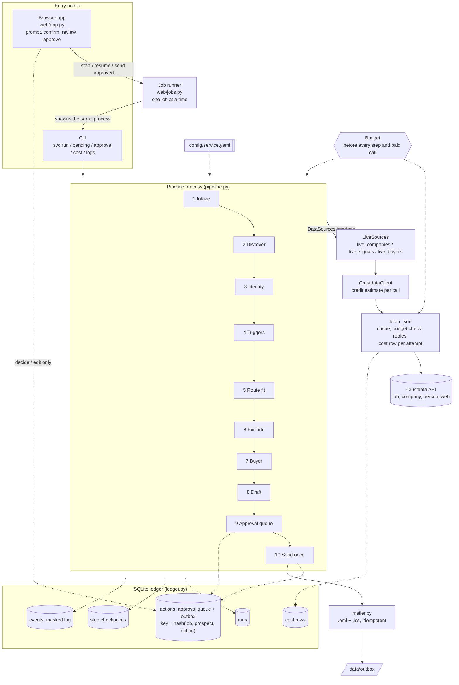
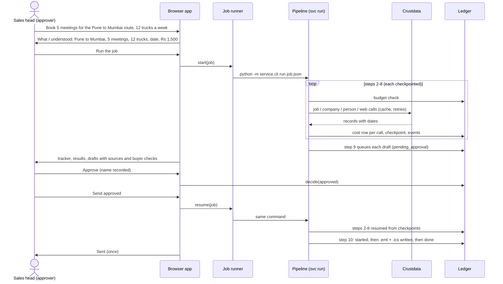
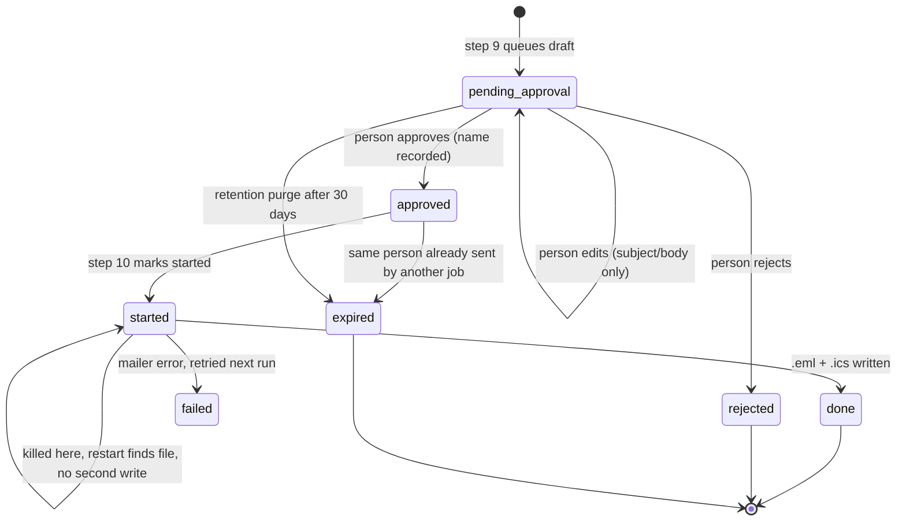

# Backhaul: architecture

One Python service takes a request through **ten steps**. Steps 2–8 checkpoint their output in a
SQLite ledger before the next step starts; steps 9–10 run every time and are idempotent through
one **approval queue + outbox**. Every external call goes through one function (`fetch_json`) that
caches, retries, checks the budget and writes a cost row. A person approves every email; only step
10 can send. A kill at any moment loses no finished work and repeats no action.

**Design principles**
1. **Facts only from sources.** Every claim is a `Fact` with at least one `Source` (URL, exact
   excerpt or API field path, record date). No model memory, no LLM-written facts.
2. **Hold rather than guess.** Ambiguity (lookalike, undated, sources disagree, source down) ends in
   *held* or *cannot verify* with the missing record named. A wrong meeting costs more than a held one.
3. **One sender.** Irreversible actions exist only in step 10, behind approval, keyed for exactly-once.
4. **Everything resumable.** Checkpoints, outbox states and an append-only cost/event log.
5. **Rules in config.** Every threshold, list, price, template and output field is in
   [`config/service.yaml`](../config/service.yaml), so the hour-3 change and the live fix are edits.

**Contents:** [1 Components](#1-components) · [2 Request lifecycle](#2-request-lifecycle) ·
[3 The ten steps](#3-the-ten-steps) · [4 Data calls](#4-data-calls-fetch_json) ·
[5 Approvals and outbox](#5-approvals-and-the-outbox) · [6 Failures and retries](#6-failures-and-retries) ·
[7 Cost ledger and budget](#7-cost-ledger-and-budget) · [8 State and storage](#8-state-and-storage) ·
[9 Kill and restart](#9-kill-and-restart-guarantees) · [10 Evidence model](#10-evidence-model) ·
[11 Configuration](#11-configuration) · [12 Browser app](#12-browser-app) ·
[13 Privacy](#13-privacy-by-design) · [14 Trade-offs](#14-design-decisions-and-trade-offs) ·
[15 Design questions](#15-design-questions) · [16 Judged properties](#16-where-each-judged-property-is-met)

---

## 1. Components



| Component | File(s) | Responsibility |
|---|---|---|
| Browser app | `web/app.py` | Login, prompt → confirm → run, job page (tracker, results, drafts), approve/edit/reject, send approved, stop/resume. Never imports the mailer or step 10 |
| Job runner | `web/jobs.py` | Starts `python -m service.cli run <request>` as a background process; one job at a time; stop = hard kill |
| CLI | `cli.py` | `run`, `pending`, `approve`, `reject`, `outbox`, `cost`, `logs`, `purge`; `--mode live/fixtures` |
| Pipeline | `pipeline.py` | Runs the steps, checkpoints 2–8, turns a step crash into `partial` and a budget stop into `stopped_limit` |
| Steps | `steps/s01…s10` | One decision each; act only on active prospects; record hold/drop/exclude/cannot-verify with a reason |
| Data sources | `sources/live*.py` | Map Crustdata responses to models with a `Source` on every value |
| HTTP | `sources/base.py`, `sources/crustdata.py` | The only way out: cache, retries, budget, credits, cost rows |
| Ledger | `ledger.py` | Runs, checkpoints, outbox state machine, cost ledger, events, retention purge, cross-job contacts |
| Mailer | `mailer.py` | `.eml` with the approved text + RFC 5545 `.ics`; checks for an existing file before writing |

## 2. Request lifecycle



## 3. The ten steps

| # | Step | Decides | Data calls (credits) | Outcomes |
|---|---|---|---|---|
| 1 | Intake | lane, meetings, trucks, request date, budget; loads client records | none | – |
| 2 | Discover | companies that posted logistics/warehouse/supply-chain jobs in the lane's cities or satellite towns in the window; employer names without an id resolved; industry and headcount filter by id; cap 10 per live job | job search (0.03/result, up to 100), company identify on names (0.2/match), company search by id | candidates; note if source down |
| 3 | Identity | one Crustdata id per company | company identify, domain first, then name (0.2/match) | **held: lookalike** (top-2 within 0.10, name shared, id or domain mismatch); cannot verify (no confident match) |
| 4 | Triggers | a dated hiring, expansion or funding event in the window | job search by id (0.03/result) + discovery's own posts (free); company enrich (2); web search + fetch for a dated expansion passage (1/page) | **dropped** (none in 30 days); **cannot verify** (undated, sources disagree, source down); same-type events within 3 days merged with all sources kept |
| 5 | Route fit | a site on the lane | company enrich for office locations (2) + job-post locations (free) | full / partial with a written reason (labelled estimate); **dropped** (no site on the lane); the on-lane post leads the email |
| 6 | Exclude | client, rival, do-not-contact | none | **excluded** |
| 7 | Buyer | a verified person to email | person search at the employer id, located in India (0.03/result); person enrich: role recheck + business email (2) | **held: no verified buyer** (wrong employer, left, non-buyer function, outside India, no business email tied to the employer); rejected candidates recorded |
| 8 | Draft | email + `.ics` from sourced facts only | none (template; every `[n]` is a sourced claim) | draft |
| 9 | Approval queue | queue for a person | none | **awaiting approval**; **excluded: already contacted** if another job queued/sent to the recipient or company in 90 days |
| 10 | Send once | send what the person approved (incl. edits) | mailer (file) | **sent**; re-checked exclusions and re-contact right before sending |

Every step follows the contract in `steps/__init__.py`: it receives all prospects, acts only on
active ones, and records each decision with a reason. Steps 2–8 are checkpointed; steps 9–10 run on
every invocation (they are free and idempotent), which is how "Send approved" works: re-running the
job resumes 2–8 from checkpoints and step 10 sends what was approved.

## 4. Data calls (`fetch_json`)

Every HTTP call in the service goes through `sources/base.fetch_json`:

1. **Cache:** the response for the same method + URL + body is read from `data/http_cache` if
   present (no cost, no network). Repeating a job re-uses earlier answers; sources keep their
   original `retrieved_at`.
2. **Budget:** `Budget.check()` (cost, time, LLM-call limits), then the call's **maximum credit
   estimate** must fit in the remaining budget (`CreditEstimate.check`). Otherwise `BudgetExceeded`.
3. **Call** with a timeout (20 s).
4. **Cost row per attempt:** estimated maximum credits, credits reported by Crustdata
   (`X-Credits-Used`), credits charged to the budget (reported, else 0 for a rejected request, else
   the estimate), HTTP status, request id, start time, duration.
5. **Retry** 408/425/429/5xx and network errors with backoff, honouring `Retry-After` and the rate-limit
   reset header (gateway 429s without headers wait 60 s); 401/403 and other 4xx are not retried.
6. On success the envelope `{data, url, retrieved_at}` is cached atomically and returned; after the
   last attempt `SourceUnavailable` is raised.

Mapping modules turn envelopes into models: every value they return carries a `Source` citing the
exact field path, e.g. `job_listings[6].metadata.date_added = '2026-10-27T11:21:52'`. A successful
empty answer is an empty list; a failure or wrong-shaped response is `SourceUnavailable`, so an
outage is never reported as "nothing found".

## 5. Approvals and the outbox



- **Key:** `hash(job_id, prospect_id, "send_email")`, so a prospect in a job can only ever have one
  email + invite. The row stores the exact payload the person approved, including edits; step 10
  sends that payload, not the in-memory draft.
- **Exactly once:** step 10 marks `started` before calling the mailer. The mailer writes the `.eml`
  atomically (temp file + rename) and, if the file already exists, returns "already sent". A kill
  between write and `done` therefore never produces a second email.
- **Edits** may change subject and body only (not the recipient or invite), must keep the
  unsubscribe line, and every `[n]` must point at a sourced claim.
- **No double contact across jobs:** before queueing, and again before sending, the ledger is
  searched for other jobs' rows to the same recipient (or company) within `approval.recontact_days`
  (90) that are pending, approved or sent. Rows keep only hashes after the retention purge, so the
  rule still holds when the person data is gone.

## 6. Failures and retries

| Failure | Handled where | Result |
|---|---|---|
| 429 / 5xx / timeout / network | `fetch_json` | retried with backoff and rate-limit headers |
| Source still failing after retries | step that called it | that company: cannot verify, "source unavailable: …"; others continue |
| All discovery sources fail | step 2 | no candidates + a "cannot verify: discovery source unavailable" note (never "no companies") |
| Unexpected exception in a step | `pipeline.run` | finished work kept, active companies held as cannot verify, status `partial`; step not checkpointed, so a re-run retries it |
| Cost or time limit | `Budget.check`, `CreditEstimate.check` | status `stopped_limit`, active companies held, nothing half-sent; raising the limit and re-running resumes |
| Typo in output config | `pipeline.run` start | job refuses to start, before any call or send |
| Process killed | checkpoints + outbox states | see section 9 |
| Two jobs for one person | steps 9 and 10 | second one excluded or expired |

## 7. Cost ledger and budget

- **What is recorded:** one row per paid call attempt (provider, operation, units, ₹/USD, ms).
  Crustdata credits are priced from config (`costs.crustdata_inr_per_credit` = ₹25.20, i.e.
  $0.30 × ₹84). LLM calls (none in the current pipeline) are priced per token from config.
- **Budget:** per job `limits.max_cost_inr` (₹1,500; a request's `budget_inr` overrides),
  `limits.max_seconds` (40 min), `limits.max_llm_calls`. Checked before every step and before every
  paid call using the call's maximum estimate, so a single expensive call cannot overshoot.
- **Reporting:** `svc cost <job>` shows ₹ per operation and, per operation, calls, statuses,
  estimated / reported / budgeted credits and calls without a reported figure; `--calls` lists
  every call with its request id for matching against Crustdata's usage.
- **Reconciliation (22 Nov 2026):** reported credits matched Crustdata; the ledger books calls that
  timed out without a reported figure at the estimate, so it can only over-state cost.
- **Measured:** a live Pune → Mumbai job cost ₹1,179 (Crustdata-reported) for 4 drafts, ₹295 per
  draft. Cost per held meeting and margin are in [PITCH.md](PITCH.md).

## 8. State and storage

| Store | Contents | Lifetime |
|---|---|---|
| `runs` | job id, request, status (`running` → `done` / `awaiting_approval` / `partial` / `stopped_limit`), summary | kept; summary cleared by retention purge |
| `steps` | output of each finished step per job (checkpoint) | deleted after 30 days |
| `actions` | approval queue + outbox rows: key, payload, status, approver | kept; payload reduced to company + contact hashes after 30 days |
| `costs` | one row per paid call attempt | kept |
| `events` | step log, warnings, errors (emails/phones masked at write) | kept |
| `data/results/<job>.json` | full result with every source | deleted after 30 days |
| `data/outbox/<key>.eml/.ics` | sent emails and invites | deleted after 30 days |
| `data/http_cache` | raw provider responses | deleted after 30 days |
| `data/requests`, `data/jobs` | browser job requests, logs, run history | kept |

SQLite runs in WAL mode with `synchronous=FULL`; step outputs and outbox transitions are committed
before the next action. The retention purge runs before every `svc run` (and `svc purge`).

## 9. Kill and restart guarantees

| Killed… | On restart (same command / Resume) |
|---|---|
| during a step 2–8 | finished steps load from checkpoints; the interrupted step runs again (its paid calls come from the cache where they completed) |
| after step 8, before approval | nothing to redo; drafts are already queued |
| after approval, before step 10 | step 10 sends the approved payload |
| inside step 10 before the mailer (`before_send`) | row is `started`, no file: the email is written once |
| inside step 10 after the mailer (`after_send`) | row is `started`, file exists: marked done, no second email |

`faults.maybe_crash()` hard-exits (`os._exit`, like `taskkill /F`) at any of these points when
`SERVICE_CRASH_AT` is set. `tests/test_kill.py` kills a real subprocess at every point and asserts
each step ran once and each email + invite exists exactly once; `scripts/demo.ps1` does the same live.

## 10. Evidence model

```text
Fact(claim="General Mills posted a GEMS Logistics Manager job in Powai, Mumbai, Maharashtra on 2026-10-27",
     value="GEMS Logistics Manager",
     sources=[Source(url="https://in.indeed.com/viewjob?jk=…", kind="api_response",
                     excerpt="job_details.title = 'GEMS Logistics Manager'; location.raw = 'Powai, Mumbai, Maharashtra';
                              metadata.date_added = '2026-10-27T11:21:52'",
                     field_path="job_listings[6].job_details.url", record_date=2026-10-27)])
CannotVerify(question="Which legal entity is Dow?",
             missing="registry record (MCA/GST) or a corroborated company domain to separate Dow / Dow Performance Silicones",
             tried=["crustdata company identify"])
```
- `Source.excerpt` must state the fact itself (validated non-empty); `record_date` is the record's
  date (post date, article date), separate from `retrieved_at`.
- A post resolved through an employer-name lookup also cites the identify response
  (`matched_on`, company id, confidence) that links the name to the company.
- Route-fit scores are rule outputs and are always shown as an estimate with the reason.

## 11. Configuration
[`config/service.yaml`](../config/service.yaml) holds: client records file; data mode; limits;
trigger window, merge window, weights, ignored types and non-freight job functions; identity
thresholds; route-fit scores and satellite towns; buyer titles, excluded functions, junior titles,
countries, business-email fetch; discovery industries, headcount band, live cap and name lookup;
email template; approval and re-contact window; privacy fields and retention; output fields
(dotted paths allowed); LLM models and prices; credit price and exchange rate. Unknown output
fields fail at job start.

## 12. Browser app
- **Pages:** New job (prompt + examples), confirm (parsed fields, rehearsal toggle), job page (step
  tracker from the event log, cost meter, results with filter tiles, drafts), Jobs, Approvals.
- **Runs jobs as processes**, not in the web server: the same `svc run` as the CLI, so a crash of
  the server or a Stop does not corrupt a job, and kill/restart semantics are identical.
- **One job at a time**, because jobs share the provider's 5 requests/minute limit.
- **Security:** password login (from `.env`), HMAC-signed session cookie (HttpOnly, SameSite=Strict),
  CSRF token on every form, the approver's name stored on every decision. The app module may not
  import the mailer or step 10 (enforced by a test). Local by default (127.0.0.1).

## 13. Privacy by design
Work data only (`privacy.person_fields`: name, title, employer, role dates, business email); a
business email is kept only when the provider ties it to the verified employer id; personal emails,
phones and posts are never requested. Matching a person requires the employer id. Logs mask emails
and phone numbers at write time. Person data is deleted after `privacy.retention_days` (30) while
outbox keys and contact hashes keep the send-once and no-double-contact guarantees.

## 14. Design decisions and trade-offs
| Decision | Why | Trade-off |
|---|---|---|
| Hiring-first discovery (job posts in the lane's cities) | posts carry a date and a location: a fresh trigger and a site in one record | misses companies that are not hiring; ~60% of posts lack a company id |
| Hold on any identity doubt | a lookalike email is worse than a missed one | multi-entity groups (LANXESS, ABB) are left out |
| Template drafts, no LLM text | no invented facts; every sentence maps to a source | plainer wording |
| Steps checkpointed, steps 9–10 always run | resume for free, send-once by key | step outputs stored per job |
| SQLite ledger, one process per job | simple, durable, inspectable at screening | single machine (see 15) |
| Budget checked against a call's maximum | a call can never overshoot the limit | conservative: some calls are refused near the limit |
| Buyers limited to the lane's country | multinationals' global executives are the wrong buyer | fewer candidates per company |

## 15. Design questions
- **100× volume.** Run steps as jobs on a queue with many workers; move the ledger tables unchanged
  to Postgres (`SELECT … FOR UPDATE` on outbox rows); share the response cache (object storage);
  batch identify/enrich calls (up to 25 ids each) and add a per-key token bucket for the provider's
  rate limit; discovery per lane runs once and fans out per company.
- **A second client.** Add `client_id` to every table and cache key; one config file, budget,
  records file and do-not-contact list per client; approvals scoped to the client's approvers;
  re-contact rules per client (and optionally across clients for the same prospect).
- **A new data source.** Implement the `DataSources` methods for it, route HTTP through
  `fetch_json` with its credit price, return `Source`s, and let step rules stay unchanged; disagreeing
  sources already end in cannot verify.
- **Real email.** Replace the file mailer with SMTP/API sending that passes the outbox key as the
  provider's idempotency key or Message-ID and checks the sent folder before retrying; approval and
  outbox are unchanged.
- **Faster runs.** Higher provider rate limit or batch endpoints; parallel per-company steps behind
  the same budget; background watchers (provider webhooks) feeding the same pipeline.

## 16. Where each judged property is met
| Property (problem statement / scoring) | Mechanism | Code | Proof |
|---|---|---|---|
| Whole job, request to result | ten steps from prompt to sent email + invite | `pipeline.py`, `steps/` | browser flow test, live run |
| Live real-world data | Crustdata job/company/person/web; live by default | `sources/live*.py` | live Pune → Mumbai job |
| Each fact linked to its record | `Fact` requires `Source` with excerpt + record date | `models.py` | evals; every draft claim |
| "Cannot verify" instead of guessing | identity, trigger and source-failure rules | `s03`, `s04`, `pipeline.py` | evals (Indus Chem, Godavari Foods) |
| No lookalikes | top-2 gap, shared names, id/domain mismatch | `s03_identity.py`, `live_companies.py` | evals |
| No departed / same-name / wrong-function buyer | employer id, recheck, country, title rules | `s07_buyer.py`, `live_buyers.py` | `test_titles.py`, evals |
| Approval before irreversible actions | approval queue; web app cannot send | `s09`, `s10`, `web/` | `test_web.py` |
| Time and cost limit; cost of each call | `Budget`, `CreditEstimate`, cost rows | `budget.py`, `sources/base.py` | `test_budget.py`, budget eval, `svc cost` |
| Survive stop + restart, each action once | checkpoints, outbox states, idempotent mailer | `ledger.py`, `s10`, `mailer.py` | `test_kill.py`, `demo.ps1` |
| Duplicates | step 2 dedupe; same-event merge; cross-job re-contact | `s02`, `s04`, `s09`, `s10` | `test_recontact.py`, evals |
| Hour-3 change, live fix | rules and output fields in YAML | `config/service.yaml`, `pipeline.summarize` | output-field tests |
| Logs and cost records at screening | masked event log, cost ledger with request ids | `ledger.py`, `cli.py` | `svc logs`, `svc cost --calls` |
| Personal data handling | work fields only, masking, 30-day retention | `privacy.py`, `ledger.py` | `test_privacy.py` |
