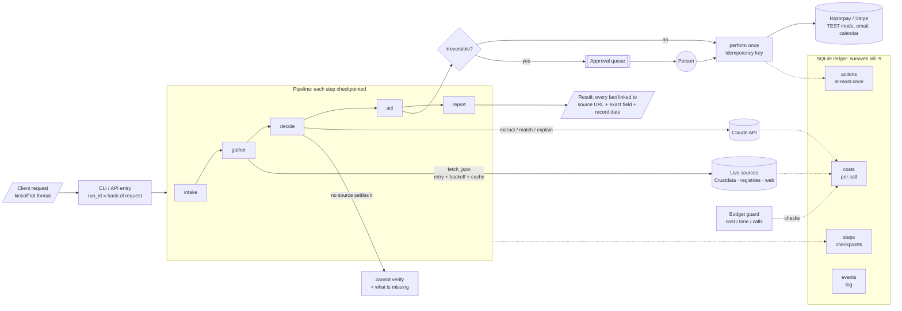

# Architecture

Required deliverable: show the components, the data flow, and **where the data calls, approvals, retries and the cost ledger sit**. Update this diagram once the track is chosen. GitHub renders Mermaid natively.

## How each judged property is met

| Property | Mechanism | Code |
|---|---|---|
| Each claim has a source | `Fact` won't construct without a `Source` that has an excerpt | `evidence.py` |
| "Cannot verify" instead of guessing | `decide` emits `CannotVerify(missing=...)` when no record settles it | `pipeline.py` |
| Approval before irreversible actions | `approval.irreversible` in config → `pending_approval` until `cli approve` | `ledger.action` |
| Kill on stage, each action once | step checkpoints + idempotency key passed to the provider as well | `ledger.py` |
| Sources fail | retry with backoff, then `SourceUnavailable` → cannot verify | `sources/base.py` |
| Time and cost limits | `Budget.check()` before every paid call; every call logged | `budget.py`, `costs` table |
| Requirement change at hour 3 | limits, required fields and prices live in `config/service.toml` | config |

## Scaling answers (system design question)
- **100× volume:** move from SQLite to Postgres (same schema), run the pipeline per item on a queue (e.g. Redis/RQ or Celery), cache source lookups per entity, batch LLM calls through the Batch API at half price.
- **Second client:** add `client_id` to every table and config profile; keep per-client records and approval rules separate.
