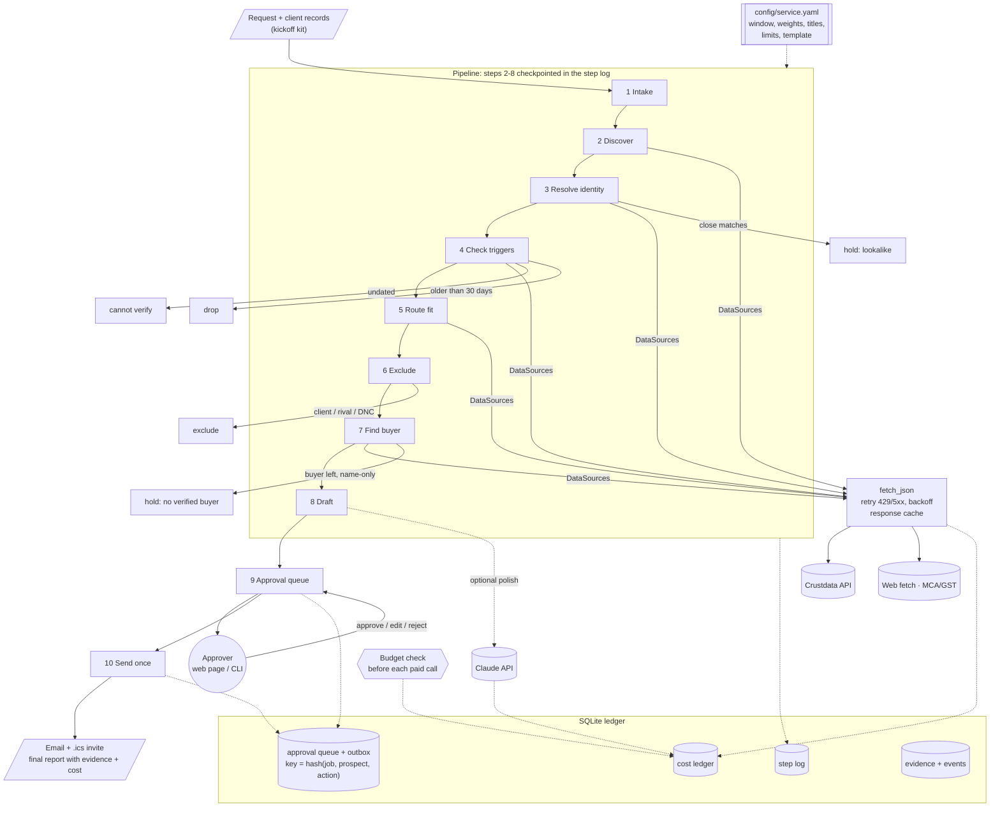

# Architecture

One Python worker takes a request through ten steps. Steps 2–8 each save their output to the step log before the next starts. Every irreversible action goes through one approval queue and outbox. A kill at any moment loses no finished work and repeats no action.

## Where each judged property is met
| Property | Mechanism | Code |
|---|---|---|
| Each fact has a source | `Fact` requires ≥1 `Source` with a non-empty excerpt and record date | `models.py` |
| Cannot verify, never guess | undated trigger, low-confidence identity, failed source → `CannotVerify` | `steps/s03`, `s04` |
| No lookalikes | identify top-2 gap, domain check | `steps/s03_identity.py` |
| No departed or same-name buyer | role end date, employer id must equal company id | `steps/s07_buyer.py` |
| Approval before email/invite | `ledger.request_approval` → person → `decide` / `update_payload` | `steps/s09_approve.py` |
| Each action once after a kill | outbox row with unique key; `started` → provider check → `done`; atomic file write | `steps/s10_send.py`, `mailer.py` |
| Restart resumes | step log per (job, step) | `ledger.step`, `pipeline.py` |
| Sources fail | retry with backoff, then `SourceUnavailable` → cannot verify | `sources/base.py` |
| Cost limit, cost per call | `Budget.check()` before each paid call; every call is a cost row | `budget.py`, `ledger.costs` |
| Hour-3 change, live fix | rules in one YAML file | `config/service.yaml` |

## Design question answers
- **100× volume:** several workers on a shared queue, Postgres instead of SQLite (same tables), Crustdata batch APIs, the response cache, and per-key rate limits.
- **A second client:** a `client_id` on every table, plus its own config file, budget and do-not-contact list.
